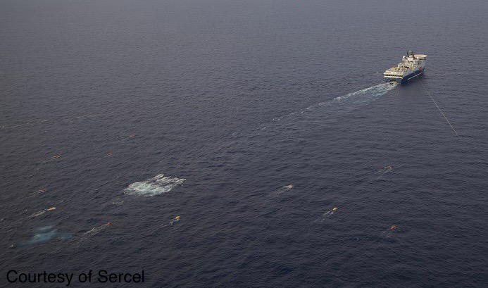

## MAM5-INUM - Commande optimale
# **TP 3 - Navigation problem (a.k.a. Zermelo-Markov-Dubins), MPC approach**

One considers a ship in a constant current $w=(w_x,w_y)$, $|w| \lt 1$. The angle of the velocity (*wrt.* to the water) is controlled, leading to the following dynamics:

$$ \begin{array}{rcl}
     \dot{x}(t) &=& w_x+\cos\theta(t),\quad t \in [0,t_f]\\
     \dot{y}(t) &=& w_y+\sin\theta(t),\\
     \dot{\theta}(t) &=& u(t). 
   \end{array} $$

The turning rate (= curvature of turns) is limited, so $|u(t)| \leq 1$. Boundary conditions are prescribed at $t=0$ and $t=t_f$ on the position $(x,y)$ and on the angle $\theta$ of the velocity in the water referential. The final time is to be minimised. The problem originates from a collaboration with the French company [CGG](https://www.cgg.com) that is interested in optimal maneuvers for very large ships doing marine prospection.



In practice the current is not constant, it depends on the position, and it is only known at the current position of the ship. One therefore cannot compute the optimal trajectory once and for all: the idea of *model predictive control* (MPC) is to solve, at each step, the problem for a constant current (the one measured at the current position), apply the control for a short time $\Delta t$, and start again from the new state.

## Discretisation

The open-loop problem (constant current) is solved by a direct method. The structure of the solution is assumed to be **three arcs** on which the control is constant: $u=u_k \in [-1,1]$ on the $k$-th arc, whose duration $\tau_k \geq 0$ is an unknown. The final time is $t_f=\tau_1+\tau_2+\tau_3$. On each arc, time is rescaled to $s\in[0,1]$, so that $t=\tau_k s$ and the dynamics become $\mathrm{d}X/\mathrm{d}s = \tau_k F(X,u_k)$. With $P$ points $s_j=(j-1)/(P-1)$, that is $P-1$ steps of length $1/(P-1)$, the Crank-Nicolson scheme reads

$$ X_{j+1} = X_j + \frac{\tau_k}{P-1}\cdot\frac{F(X_j,u_k)+F(X_{j+1},u_k)}{2},\quad j=1,\dots,P-1. $$

The three arcs are glued by continuity of the state $(x,y,\theta)$.

## Questions

1. Why does the discretisation of an arc with $P$ points involve $P-1$ steps of length $\tau_k/(P-1)$, and not $\tau_k/P$ ?
2. Complete the function `solve_direct` (JuMP model, solved with Ipopt) : variables, objective, boundary conditions, continuity between arcs, Crank-Nicolson dynamics. Check that it returns $u_1\simeq 1$, $u_3\simeq -1$ for the data given.
3. Open loop : simulate the control found for the constant current $w(x_0,y_0)$ on the real system. How far from the target is the final point? How does it change with $P$?
4. MPC : run the loop and compare with the open-loop trajectory. What is the influence of $\Delta t$, $\varepsilon$ and $P$ ?

## Problem definition

```julia
using JuMP, Ipopt, Plots, OrdinaryDiffEq, LinearAlgebra

t0 = 0.
x0 = 0. 
y0 = 0.
θ0 = π/7
xf = 4.
yf = 7.
θf = -π/2

function drift(x, y) # current as a function of position
    ε = 1e-2
    w = [ 0.6, 0.4 ]
    δw = ε * [ y, -x ] / sqrt(1+x^2+y^2)
    w = w + δw
    if (w[1]^2 + w[2]^2 >= 1)
        error("|w| >= 1")
    end
    return w
end
```

## Solver (JuMP)

```julia
function solve_direct(x0, y0, θ0, xf, yf, θf, w, P=50; tol=1e-8, max_iter=500, print_level=5)

    sys = Model(Ipopt.Optimizer)
    set_attribute(sys, "print_level", print_level)
    set_attribute(sys, "tol", tol)
    set_attribute(sys, "max_iter", max_iter)

    # TO BE UPDATED
    # - variables: x, y, θ (3 arcs x P points), u (3 values in [-1, 1]), τ (3 durations >= 0)
    # - objective: final time
    # - boundary conditions and continuity between the arcs
    # - dynamics: Crank-Nicolson scheme, P-1 steps of length τ[k]/(P-1) on arc k
    # - optimize!, then extract the values of u and τ
    us = zeros(3)
    τs = ones(3)

    return us, τs

end
```

## Simulation of the real system

```julia
function trajectory(tspan, x0, y0, θ0, us, ts, drift; abstol=1e-12, reltol=1e-12, saveat=[])

    function rhs!(dX, X, dummy, t)
        w = drift(X[1], X[2])
        if t < ts[1]
            u = us[1]
        elseif t < ts[2]
            u = us[2]
        else
            u = us[3]
        end
        dX[1] = w[1]+cos(X[3])
        dX[2] = w[2]+sin(X[3])
        dX[3] = u
    end

    X0 = [ x0, y0, θ0 ]
    ode = ODEProblem(rhs!, X0, tspan)
    sol = solve(ode, Tsit5(), abstol=abstol, reltol=reltol, saveat=saveat)
    return sol

end
```

## Open-loop control (no feedback)

Solve once with the current measured at the initial position, then apply this control to the real system: the final point misses the target because the current actually varies with the position.

```julia
P = 20 # number of points for direct solve

w0 = drift(x0, y0)
us0, τs0 = solve_direct(x0, y0, θ0, xf, yf, θf, w0, P, print_level=0)
tf0 = sum(τs0)
sol0 = trajectory((t0, tf0), x0, y0, θ0, us0, [τs0[1], τs0[1]+τs0[2]], drift)
println("open loop: tf = ", tf0, "\t final error: ", norm(sol0.u[end] - [xf, yf, θf]))
```

## Main loop (MPC)

The loop is in a function, which avoids any ambiguity on the scope of the variables when the code is run as a script.

```julia
function mpc(x0, y0, θ0, xf, yf, θf, drift; t0=0., Δt=1.0, P=20, ε=1e-1, Nmax=20)

    t1, x1, y1, θ1 = t0, x0, y0, θ0
    t, x, y, θ, u = Float64[], Float64[], Float64[], Float64[], Float64[]

    for N in 1:Nmax+1

        w = drift(x1, y1) # current sampled at (x1,y1)
        us, τs = solve_direct(x1, y1, θ1, xf, yf, θf, w, P, print_level=0)
        ts = [ t1+τs[1], t1+τs[1]+τs[2] ]
        tf = t1+sum(τs) # predicted final time
        t2 = min(t1+Δt, tf)
        sol = trajectory((t1, t2), x1, y1, θ1, us, ts, drift)

        append!(t, sol.t)
        append!(x, sol[1, :])
        append!(y, sol[2, :])
        append!(θ, sol[3, :])
        append!(u, [ s < ts[1] ? us[1] : s < ts[2] ? us[2] : us[3] for s in sol.t ])

        t1, x1, y1, θ1 = t2, x[end], y[end], θ[end]
        err = norm([ x1, y1, θ1 ] - [ xf, yf, θf ])
        println("N: ", N, "\t t: ", round(t1, digits=3), "\t predicted tf: ", round(tf, digits=3), "\t err: ", err)
        err > ε || break

    end

    return t, x, y, θ, u

end

t, x, y, θ, u = mpc(x0, y0, θ0, xf, yf, θf, drift, t0=t0, Δt=1.0, P=P, ε=1e-1, Nmax=20)
```

## Plots: states, control and trajectory

```julia
x_plot = plot(t, x, xlabel="t", ylabel="position x", legend=false, fmt=:png)
y_plot = plot(t, y, xlabel="t", ylabel="position y", legend=false, fmt=:png)
θ_plot = plot(t, θ, xlabel="t", ylabel="θ", legend=false, fmt=:png)
u_plot = plot(t, u, xlabel="t", ylabel="control", legend=false, fmt=:png)
display(plot(x_plot, y_plot, θ_plot, u_plot, layout = (2,2)))

traj_plot = plot(x, y, color=:black, lw=3, label="MPC", xlabel="x", ylabel="y", legend=:topleft)
plot!(traj_plot, sol0[1, :], sol0[2, :], color=:blue, lw=2, linestyle=:dash, label="open loop")
plot!(traj_plot, [x0, xf], [y0, yf], seriestype=:scatter, color=:green, markersize=6, label="start / target")
plot!(size=(600,600))

step = 5
for i = 1:step:length(t)
    plot!([ x[i] ], [ y[i] ], seriestype = :scatter, color =:red, label=false) 
end
display(traj_plot)
```
